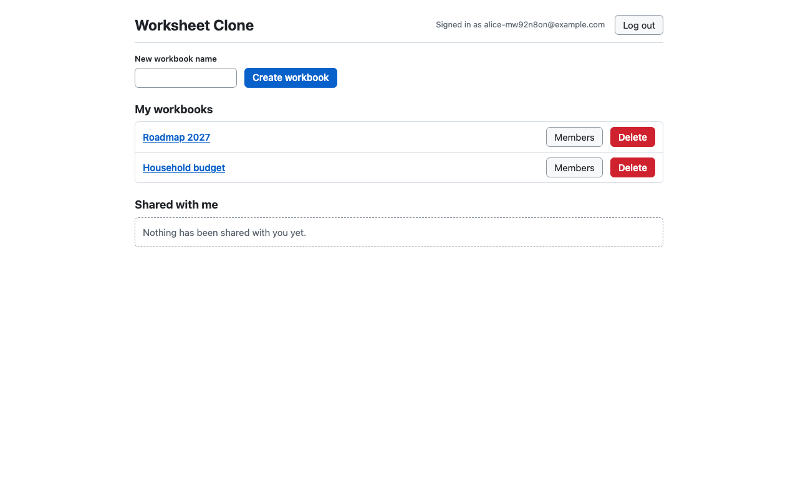
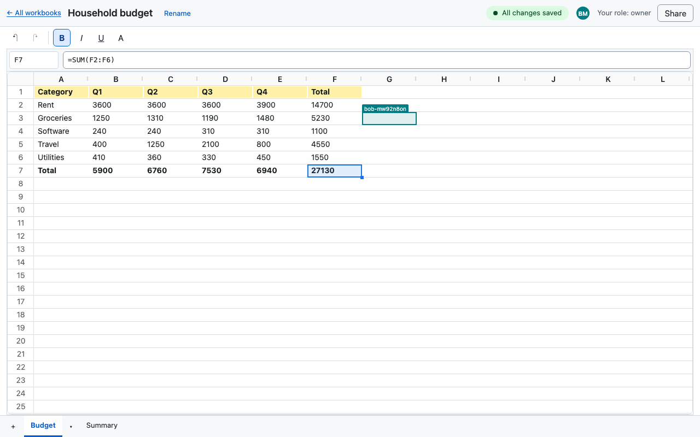
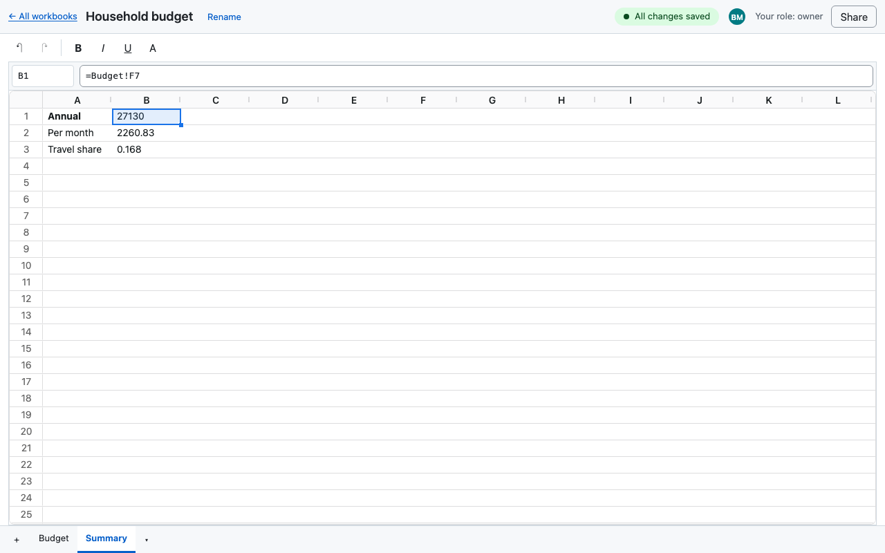
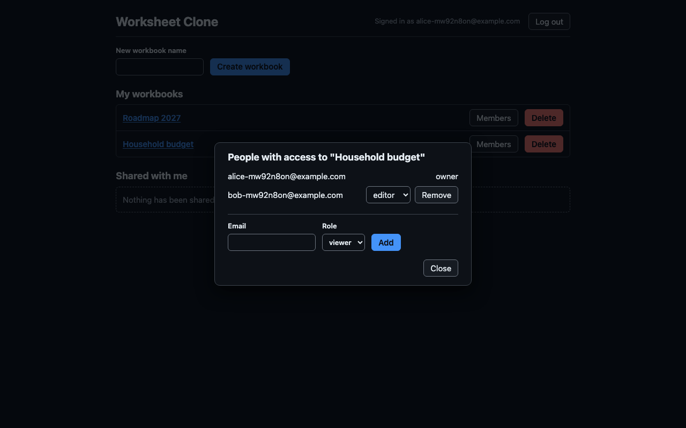

# Worksheet Clone

A real-time, multi-user spreadsheet in the browser (Google Sheets style). Sign up, create workbooks with several sheets, share them with other people by email, and edit together: every change appears for everyone as it happens, formulas recompute on each machine, and edits made offline merge when you reconnect.

It is a personal project for learning CRDT-based realtime systems, formula engines, grid virtualization and disciplined AI-assisted development. It is not deployed anywhere yet; see [docs/deploy.md](./docs/deploy.md).

|                                                                  |                                                                     |
| ---------------------------------------------------------------- | ------------------------------------------------------------------- |
|                |        |
|  |  |

The screenshots show a small budget workbook: totals with `SUM`, a second sheet reading from the first (`=Budget!F7`), some formatting, and a collaborator's cursor and avatar. They are generated by `pnpm screenshots` (below).

## Features

- **Accounts and sharing.** Email + password sign-up (argon2id, server-side sessions in an httpOnly cookie). Workbooks have owners, editors and viewers; owners add people by the email of an existing account. Viewers are read-only on the server, not just in the UI.
- **Live collaboration.** One Yjs document per workbook over a WebSocket; concurrent edits merge without conflicts. Collaborators appear as avatars and coloured cell cursors and selections.
- **Spreadsheet basics.** Virtualized grid (100 x 26 by default), cell selection and ranges, an Excel/Sheets keyboard map, in-cell editor and a formula bar with a name box, copy / cut / paste as TSV (works with Excel and Sheets), fill handle with series detection and relative formulas, undo / redo that only undoes your own changes.
- **Formulas.** HyperFormula (GPL key) evaluates on each client from the stored inputs; references are stored by row/column id so they survive concurrent row and column changes (a deleted referent becomes `#REF!`). Cross-sheet references such as `Sheet2!A1` work.
- **Sheets.** Tabs to add, rename, hide / unhide, delete, reorder and switch; the active sheet is in the URL.
- **Formatting.** Bold, italic, underline and background colour for the selection, one undo step per action.
- **Structure.** Insert, delete and reorder rows and columns, resize them; all done on stable ids so a collaborator's edit lands in the right cell.
- **Resilience.** Sync status indicator, an on-device cache so edits survive being offline or reloading, automatic reconnect and merge, banners when access is revoked or a workbook is too large, a "waking up" state for a sleeping server.
- **Production hardening.** Security headers and CSP, same-origin checks on state-changing requests and WebSocket upgrades, rate limits, size limits for requests, messages and workbooks, graceful shutdown that flushes documents, migrations on start.

Not built: version history, number formats, frozen panes, comments, email invites, and a dark theme for the grid itself (the rest of the app follows the system theme).

## Architecture in brief

```
Browser: React + Redux (UI state only) -> Y.Doc (source of truth) -> HyperFormula -> SheetViewModel -> GridView port -> AG Grid (render-only adapter)
   |  REST /api            |  WebSocket /collab (Yjs sync + awareness)
Server (one Node process): Fastify routes + Hocuspocus, framework-free domain/ layer -> Postgres (users, sessions, workbooks, members, Yjs state)
```

- **Yjs is the source of truth** for content; computed values are never stored. Redux holds UI state and REST caches.
- **The grid library is a dumb painter** behind a `GridView` port; selection, keyboard, editing, fill and clipboard are ours. See [ADR-0001](./docs/adr/0001-grid-abstraction.md).
- Rationale for every decision, with the alternatives considered: [PROJECT_CONTEXT.md](./PROJECT_CONTEXT.md). Build plan: [docs/PLAN.md](./docs/PLAN.md). Conventions: [CLAUDE.md](./CLAUDE.md). Runtime behaviour, limits and backups: [docs/operations.md](./docs/operations.md).

## Run it locally

Prerequisites: Node 24 (`.nvmrc`), pnpm via Corepack, Docker Desktop.

```bash
pnpm install
docker compose -f docker/docker-compose.yml up -d postgres   # development database on :5432
pnpm dev          # server (watch) on :3000 and Vite on :5173
```

Quality gates (also what CI runs):

```bash
pnpm format:check && pnpm lint && pnpm typecheck
pnpm test             # unit + functional, all packages
pnpm test:e2e:server  # real server + Testcontainers Postgres + real WebSocket clients
pnpm test:e2e:web     # Playwright, hermetic (mocked REST and WebSocket)
```

## Run the production image locally

```bash
pnpm docker:up      # builds docker/Dockerfile, starts it with its own Postgres on http://localhost:8080
pnpm test:smoke     # Playwright against that running stack: two users, live sync, headers, limits
pnpm screenshots    # regenerates docs/screenshots from that stack
pnpm docker:down
```

Production-mode rate limits apply, and signup is limited to 5 per hour per IP; if the smoke or screenshot run reports a 429, restart the app container (`docker compose -f docker/docker-compose.prod.yml restart app`). Backups: `pnpm db:dump` / `pnpm db:restore`.

## Deploying

Hosting is planned on Railway (the container) with Neon (Postgres); `railway.toml` and the step-by-step checklist are in [docs/deploy.md](./docs/deploy.md).

## License

GPL-3.0-only, see [LICENSE](./LICENSE). HyperFormula is used under its GPLv3 key, so the project must stay GPLv3-compatible while it is distributed.
